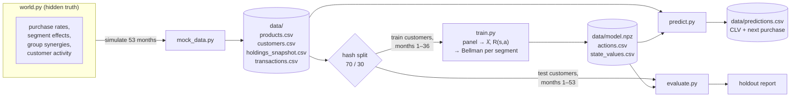
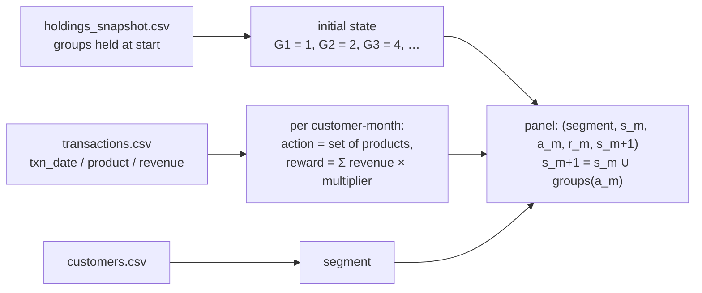
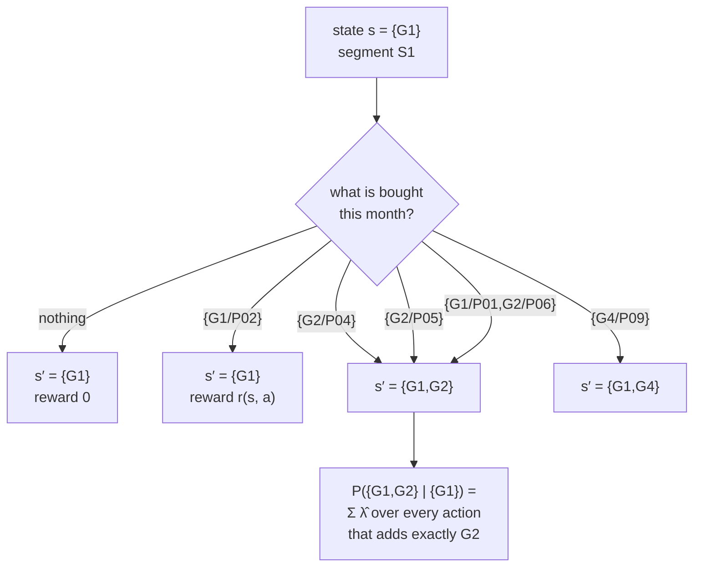
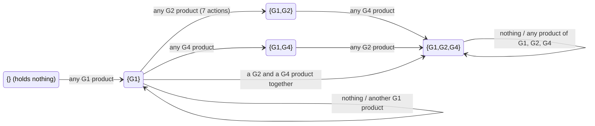
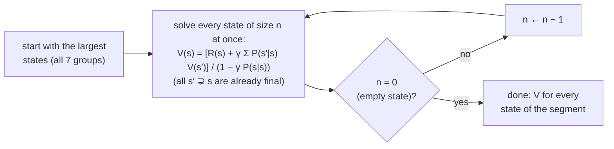
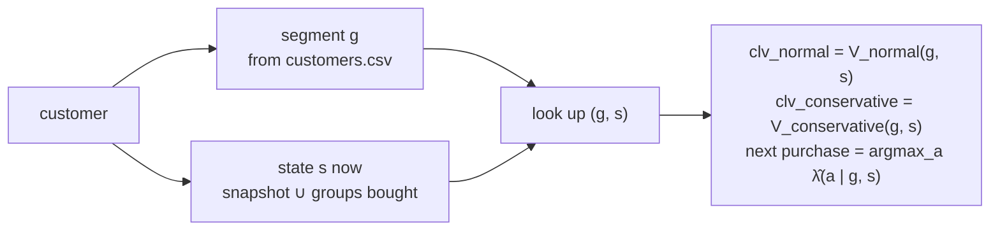

# Customer Lifetime Value as an MDP — lab

Learn a Markov decision process from (mock) product-purchase history, then use the
Bellman equation to predict each customer's CLV and product journey. This page covers
the mock world, the MDP learned from it, how the Bellman equation turns that MDP into
CLV, and how the result is scored on held-out customers.

## Layout

```
src/
  world.py      mock world: anonymised product catalog, hidden true behaviour, simulator
  mdp.py        the model: tables -> monthly states, estimate the MDP, Bellman solvers
  mock_data.py  step 0: write mock tables to data/
  train.py      step 1: estimate the MDP on train customers, solve Bellman, save data/model.npz
  predict.py    step 2: CLV + most likely next purchase per customer -> data/predictions.csv
  evaluate.py   step 3: score test customers' realised revenue against the model
tests/test_mdp.py
```

```bash
uv sync
uv run src/mock_data.py
uv run src/train.py
uv run src/predict.py
uv run src/evaluate.py
uv run pytest -q
```

## End-to-end pipeline



The model only ever sees the four CSV tables. The hidden parameters in `world.py` are
used only to generate the history.

## 1. The mock world (`world.py`)

A stand-in for a retail bank. Products, product groups and segments are anonymised as
running numbers.

**Products:** 18 products (`P01`–`P18`) in 7 product groups (`G1`–`G7`). `P12` is a
one-time product (e.g. a single-trip policy); every other product earns revenue over
several years.

| group | products |
|---|---|
| G1 | P01, P02, P03 |
| G2 | P04, P05, P06 |
| G3 | P07, P08 |
| G4 | P09, P10, P11, P12 (one-time) |
| G5 | P13, P14 |
| G6 | P15, P16 |
| G7 | P17, P18 |

**Customers:** 50,000 in 4 segments, `S1` (45%, lowest value) to `S4` (8%, highest
value). Everyone exists at the start of the journey. The snapshot taken just before
records which groups each customer already holds. About 5% hold nothing.

**Hidden behaviour**, used to simulate the history but never read by the model:

- Each month every product may be bought, with a probability that depends on:
  - the product's base rate;
  - the segment;
  - **groups already held**: e.g. holding G1 raises appetite for G2;
  - holding the product's own group: another product of that group is half as likely;
  - a hidden per-customer activity level (Gamma, mean 1). The model cannot see it,
    so this is the main source of model error;
  - customers who hold nothing buy at 30% of the normal rate.
- Booked revenue of a purchase is lognormal around the product's mean, scaled by
  segment. 5% of non-one-time purchases are approved but never booked (revenue 0).
- Several products can be bought in the same month.

**Mock tables written to `data/`:**

| file | columns |
|---|---|
| `products.csv` | `product_id, group_id, one_time` |
| `customers.csv` | `customer_id, segment` |
| `holdings_snapshot.csv` | `customer_id, group_id` (groups held just before the journey starts) |
| `transactions.csv` | `customer_id, txn_date, product_id, revenue` (booked revenue) |

## 2. The MDP (`mdp.py`)

| element | definition |
|---|---|
| time step | one month (transaction dates are bucketed into months) |
| segment | a **model key**, not part of the state: every estimate and every Bellman solve is done per segment |
| state *s* | the **set of product groups ever held**, e.g. `{G1,G2}` (2⁷ = 128 per segment). Groups are only added, never removed |
| action *a* | the **set of products bought during the month**, e.g. `{G2/P05,G4/P12}`. Buying nothing is the implicit "no purchase" action |
| transition | deterministic given the action: *s′ = s ∪ groups(a)* |
| reward *R(s,a)* | mean, over occurrences of *(s, a)*, of the month's Σ booked revenue × multiplier |
| discount | γ = 0.998890³⁰ ≈ 0.9672 per month (daily rate compounded over 30 days) |

Two consequences of these definitions:

- **Many actions lead from A to B.** In S1, a customer in `{G1}` reaches `{G1,G2}`
  through 7 different observed actions (any G2 product, alone or with a G1 product).
  P(`{G1,G2}` | `{G1}`) is their sum, 1.05% per month.
- **A purchase can leave the state unchanged.** Buying another product of a group
  already held, e.g. `{G1/P02}` from `{G1}`, is a self-loop that still earns reward.
  53% of purchase-months in the mock data are like this.

### From event tables to monthly states

`build_panel` turns the tables into one state per customer per month. `state[c, m]`
is the snapshot's groups plus the groups of everything bought **before** month *m*.
Everything bought in month *m* is one compound action that moves the customer from
`state[c, m]` to `state[c, m+1]`.



The last column of the panel, after the last month of data, is each customer's
"as of now" state, which `predict.py` scores.

### Reward

Booked revenue is the expected **first-year** revenue of a product. The multiplier
spreads it over the product's lifetime, capped at 36 months, and discounts it:

```
multiplier = (1/12) × Σ_{k=0..35} γ^k = (1/12) × (1 − γ^36) / (1 − γ) ≈ 1.777
multiplier = 1                                   for one-time products (P12)
```

Two estimates of *R(s,a)* are kept:

| estimate | R(s,a) |
|---|---|
| normal | arithmetic mean of the month's reward |
| conservative | geometric mean, exp(E[ln(1 + r)]) − 1. Damps a few very large deals |

### Estimating the model

For each segment, count over all months *m* of the training window:

- *N_m(s)*: customers in state *s* at the start of month *m*;
- *N_m(s, a)*: of those, customers who took action *a* during month *m*.

```
λ̂(a|s)   = Σ_m N_m(s, a) / Σ_m N_m(s)          monthly rate of action a in state s
sd(λ̂)    = √(Σ_m N_m(s, a)) / Σ_m N_m(s)        Poisson standard error

R(s)     = Σ_a λ̂(a|s) · R(s, a)                 expected reward of a month in s

P(s′|s)  = Σ_{a : s ∪ groups(a) = s′} λ̂(a|s)    for s′ ≠ s
P(s|s)   = 1 − Σ_{s′ ≠ s} P(s′|s)               no purchase, or a same-group purchase
```

There is no smoothing: a state never seen in training has R = 0 and P(s|s) = 1, so
V = 0.

### One month as a transition



### Example: part of one segment's state graph



## 3. Bellman equation (`train.py`)

CLV of a customer = V(state): the expected discounted sum of monthly rewards from now
on, under the purchase behaviour seen in the history.

```
V(s) = R(s) + γ Σ_s′ P(s′|s) V(s′)
```

Because states only grow, every transition goes to a strict superset or stays put. The
state graph is a DAG ordered by set size, so moving the self-loop to the left-hand side
gives an exact one-pass solution, no iteration needed:

```
V(s) = [ R(s) + γ Σ_{s′ ≠ s} P(s′|s) V(s′) ] / (1 − γ P(s|s))
```



This is solved twice per segment, with normal and conservative rewards. For evaluation,
`finite_horizon` gives the T-month value `V_T(s) = Σ_{t<T} γ^t E[R(s_t) | s_0 = s]` by
T Bellman backups.

**Training paradigm.** Customers are split 70/30 by a salted hash of `customer_id`
(deterministic across runs). The model is estimated on the **train** customers over the
first **36 months** only. The remaining 17 months and the test customers are kept for
evaluation.

Outputs:

| file | content |
|---|---|
| `data/model.npz` | per segment × state: `R_normal`, `R_conservative`, `P`, `P_lower`, exposure `n_s`, `V_normal`, `V_conservative` |
| `data/actions.csv` | per segment × state × action: `next_state, n_sa, n_s, lambda, sd_lambda, mean_reward, geom_reward` |
| `data/state_values.csv` | per segment × state seen in training: customer-months, R(s), P(s\|s), CLV normal and conservative |

## 4. Inference (`predict.py`)

For every customer, `predict.py` takes their segment and their state as of now and looks
up the saved values:



Output columns in `data/predictions.csv`: `customer_id, segment, state,
seen_in_training, clv_normal, clv_conservative, p_purchase_next_month,
most_likely_next_action, p_most_likely`.

## 5. Evaluation (`evaluate.py`)

Each **test** customer's realised discounted reward over the whole data window
(T = 53 months from the start of the journey, `Σ_t γ^t r_t`) is compared with the
model's `V_53` of their **initial** state. Customers are grouped by (segment, initial
state), and each group's mean, standard error and 95% interval is compared with three
estimates:

1. **normal**: normal rewards, normal transitions;
2. **conservative**: geometric-mean rewards, normal transitions;
3. **p − 1SE**: normal rewards, every s → s′ rate lowered by one Poisson standard error,
   with the removed probability left in the self-loop.

Metrics: the standardised RMS error `L_53 = √mean(((estimate − observed) / SE)²)` over
groups with at least 30 test customers (1 ≈ within sampling noise), Spearman rank
correlation, how many of those groups fall below / above the 95% interval, and the
customer-weighted ratio of predicted to observed mean.

Results on the default run (seed 0, 50,000 customers, 53 months; 15,039 test customers
in 310 groups, 65 with ≥ 30 customers):

| estimate | L_53 | Spearman (n ≥ 30) | below / above 95% | predicted / observed |
|---|---|---|---|---|
| normal | 1.92 | 0.912 | 7 / 8 | 0.966 |
| conservative | 3.53 | 0.912 | 28 / 0 | 0.594 |
| p − 1SE | 1.90 | 0.907 | 8 / 8 | 0.943 |

- **The normal estimate is close to calibrated overall** (−3.4%), with errors about
  twice the sampling noise.
- **Ranking across all groups is good** (0.91), but mostly because it separates
  segments. Within a segment, the ranking of reliable groups is much weaker
  (Spearman about 0 to 0.6). The unseen per-customer activity blurs the differences
  between states.
- **Conservative rewards under-predict by ~40%.** The mock revenue is lognormal with
  σ = 0.8, so the geometric mean is well below the mean.
- **p − 1SE barely moves the value.** With 35k training customers the rate standard
  errors are small; it matters more for thin states.

## Limits

- **No control.** Actions are what customers bought, not what the bank did, so this
  values the current behaviour; it cannot say which offer to make.
- **Ever-holding states.** Closing a product never changes the state, and revenue after
  purchase is folded into the 36-month multiplier rather than tracked month by month.
- **No smoothing.** Rare states get noisy λ̂ and R, e.g. a state seen for 5 customer-months
  can top the CLV table. States never seen in training get CLV 0.
- **Stationarity.** λ̂ pools all 36 months; trends or seasonality in N_m(s,a)/N_m(s)
  are averaged away.

## Ideas to try next

- Shrink λ̂ and R(s,a) toward the parent state or the all-segment estimate for thin states.
- Add the customer's purchase count or tenure to the state, to capture part of the
  unobserved activity level.
- Back-test the stationarity assumption: plot N_m(s,a)/N_m(s) over months and check its
  coefficient of variation.
- Add bank offers to the history to get a real control problem, with offer → purchase as
  the action effect.
