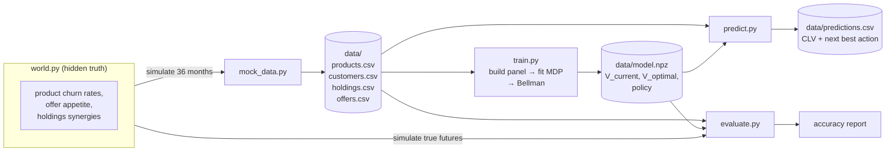
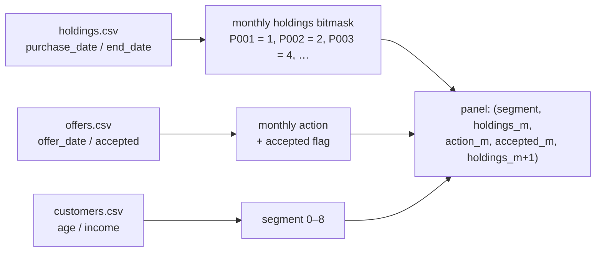
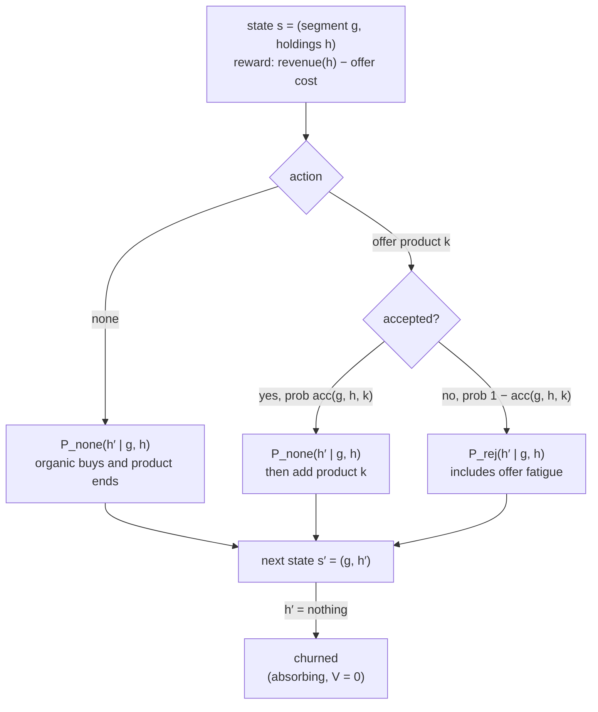
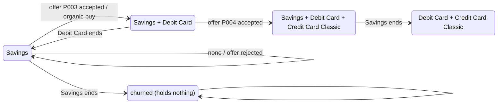
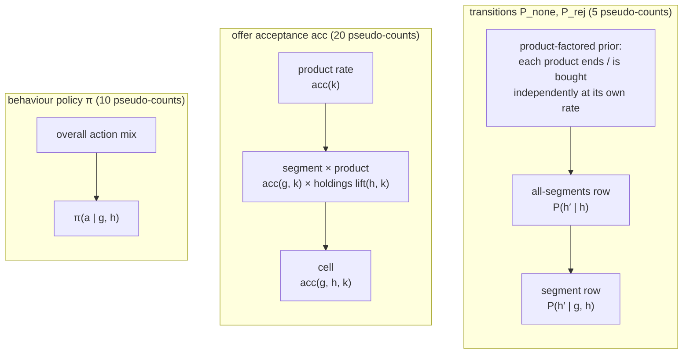
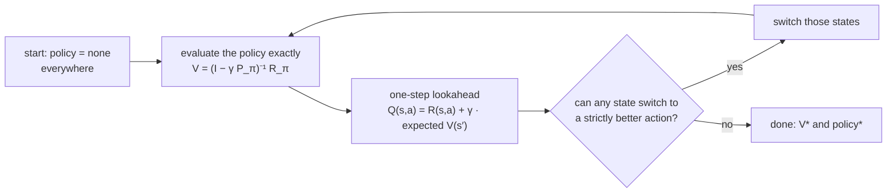
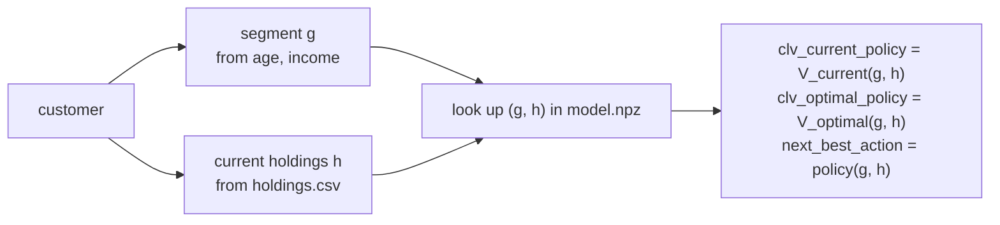

# Customer Lifetime Value as an MDP — lab

Learn a Markov decision process from (mock) product-holding history, then use the
Bellman equation to predict each customer's CLV and the next best offer. This page
covers the mock world, the MDP learned from it, how the Bellman equation turns that
MDP into CLV, and how the result is scored.

## Layout

```
src/
  world.py      mock world: product catalog, hidden true behaviour, simulator
  mdp.py        the model: tables -> states, learn the MDP, Bellman solvers
  mock_data.py  step 0: write mock tables to data/
  train.py      step 1: learn the MDP, solve Bellman, save data/model.npz
  predict.py    step 2: CLV + next best offer per customer -> data/predictions.csv
  evaluate.py   step 3: score predictions against the simulated truth
tests/test_mdp.py
```

```bash
uv sync
uv run src/mock_data.py
uv run src/train.py
uv run src/predict.py
uv run src/evaluate.py
uv run pytest -q
```

## End-to-end pipeline



The model only ever sees the four CSV tables. The hidden parameters in `world.py` are
used for two things: generating the history, and simulating customers' true futures
in `evaluate.py`.

## 1. The mock world (`world.py`)

A stand-in for a real retail bank.

**Products:** 10 products, each with a category, a tier, an estimated monthly revenue,
and a hidden monthly churn rate of 0.8–4%.

| id | product | category | tier | revenue / month |
|---|---|---|---|---|
| P001 | Savings Account | deposit | basic | 3 |
| P002 | Fixed Deposit | deposit | standard | 8 |
| P003 | Debit Card | card | basic | 2 |
| P004 | Credit Card Classic | card | standard | 15 |
| P005 | Credit Card Platinum | card | premium | 40 |
| P006 | Personal Loan | loan | standard | 35 |
| P007 | Home Loan | loan | elite | 120 |
| P008 | Life Insurance | insurance | premium | 30 |
| P009 | Mutual Fund | investment | premium | 45 |
| P010 | Wealth Management | investment | elite | 150 |

**Customers:** 20,000, with age, monthly income, occupation (salaried, self-employed,
student, retired) and signup date. New customers start with a Savings Account (70%),
Debit Card (15%) or Credit Card Classic (15%). 40% of new savers also get a Debit Card.

**Hidden behaviour**, used to simulate the history but never read by the model:

- Whether a customer accepts an offer depends on:
  - the product's base appeal;
  - age band and occupation, by product category;
  - affordability: income relative to the product's tier;
  - **current holdings**: a deposit raises appetite for cards, a loan for insurance,
    and holding one tier raises appetite for the next tier up.
- Customers also buy unprompted, at 2% of their offer-acceptance rate.
- Each held product ends at its own churn rate. Holding more products makes each one
  stickier. A rejected offer raises churn by 15% that month.
- A customer whose last product ends has left for good.

**History:** each month the bank offers a random product with probability 0.3, and
skips the offer if the customer already holds that product. That works out to an
offer in about 25% of customer-months.

**Mock tables written to `data/`:**

| file | columns |
|---|---|
| `products.csv` | `product_id, name, category, tier, est_monthly_revenue` |
| `customers.csv` | `customer_id, age, monthly_income, occupation, signup_date` |
| `holdings.csv` | `customer_id, product_id, purchase_date, end_date` (empty = still held) |
| `offers.csv` | `customer_id, product_id, offer_date, accepted` |

`offers.csv` is what makes the effect of an action learnable. Purchases alone show what
customers did, not what the bank did.

## 2. The MDP (`mdp.py`)

| element | definition |
|---|---|
| time step | one month (event dates are bucketed into months) |
| state | `(segment, holdings)`: segment = age band (<30, 30–49, 50+) × income band (<25k, 25k–60k, 60k+) = 9; holdings = exact set of products held = 2^10 = 1,024. **9,216 states** |
| absorbing state | holdings = nothing → the customer has left; reward 0 forever |
| action | `none`, or `offer_P001` … `offer_P010` (11); a product already held is never offered |
| reward | sum of `est_monthly_revenue` of held products − 2 per offer |
| discount | γ = 0.99 per month |

### From event tables to monthly states

`build_panel` turns the event tables into one holdings bitmask per customer per month.
`mask[c, m]` is what customer *c* holds at the **start** of month *m*. An offer, purchase
or end dated in month *m* moves the customer from `mask[c, m]` to `mask[c, m+1]`.



The last column of the panel, one month past the last event, is each customer's
"as of now" state, which `predict.py` scores.

### One month as a transition



So the transition for any offer is assembled from three learned pieces, instead of
estimating a separate 1,024 × 1,024 table for each of the 11 actions:

```
P(h′ | g, h, offer k) =      acc[g, h, k]  × P_none[g, h, ·] with product k added
                      + (1 − acc[g, h, k]) × P_rej[g, h, h′]
```

### Example: a few states of one customer



### Learning from sparse data

Most of the 9,216 states are rarely or never seen in the history, so every estimate
is shrunk toward a broader one, using pseudo-counts.



## 3. Bellman equation (`train.py`)

CLV of a customer = V(state): the expected discounted sum of monthly rewards from now on.

| quantity | Bellman equation | solved by |
|---|---|---|
| CLV under the current policy | `V(s) = Σ_a π(a\|s) [R(s,a) + γ Σ_s′ P(s′\|s,a) V(s′)]` | exact linear solve per segment: `V = (I − γ P_π)⁻¹ R_π` |
| optimal CLV + next best offer | `V*(s) = max_a [R(s,a) + γ Σ_s′ P(s′\|s,a) V*(s′)]` | policy iteration |



`train.py` saves `V_current`, `V_optimal` and `policy` (each indexed by segment ×
holdings) to `data/model.npz`.

## 4. Inference (`predict.py`)

For every customer still holding at least one product, `predict.py` takes their
holdings as of now and their segment, and looks up the saved values:



Output columns in `data/predictions.csv`: `customer_id, age, monthly_income,
occupation, holdings, monthly_revenue, clv_current_policy, clv_optimal_policy,
next_best_action`.

## 5. Evaluation (`evaluate.py`)

This step is only possible because the data is mocked. It samples 3,000 current
customers and simulates each one's true future 30 times in `world.py`, for up to 480
months. It does this once under the bank's historical behaviour and once under the
learned policy, then compares the realised discounted profit with the predictions.

Results on the default run (seed 0, 20,000 customers, 36 months):

| CLV under current policy | predicted | true | error |
|---|---|---|---|
| lowest fifth of customers | 2,336 | 1,840 | +27.0% |
| 2nd fifth | 5,229 | 4,619 | +13.2% |
| middle fifth | 8,807 | 8,821 | −0.2% |
| 4th fifth | 11,092 | 11,553 | −4.0% |
| highest fifth | 16,453 | 17,988 | −8.5% |
| **overall** | **8,618** | **8,785** | **−1.9%** |

| learned policy, mean CLV per customer | value |
|---|---|
| true, current policy | 8,785 |
| true, learned policy | 23,314 (+165%) |
| model's own prediction of the optimum | 27,629 (+18.5% too high) |

- **Ranking is good.** The per-customer correlation between predicted and true CLV
  is 0.93.
- **Predictions are pulled toward the middle.** The 9 segments are coarser than what
  truly drives behaviour (exact income, occupation).
- **The optimum is over-predicted.** The `max` in the Bellman optimality equation
  favours actions whose estimates happen to be too high, and the best policy steers
  customers into holdings the history barely covers.
- **The +165% uplift is an artefact of the invented world**, where offers work well.
  It is not a real-world estimate.

## Limits

- **Scaling:** exact holdings as the state is 2^K states. It stops being practical at
  around 12 products. More products would need compressed holdings (e.g. counts per
  tier) or an approximate value function.
- **Low churn:** in the mock world only about 8% of customers leave within 36 months,
  so most of a CLV comes from products the customer is expected to buy later.

## Ideas to try next

- Finer or learned segments (or a regression model for acceptance and churn) to fix the
  pull toward the middle.
- Pessimism: optimise against a lower confidence bound to curb the optimal-policy over-prediction.
- Back-test: train on the first 24 months, compare with realised revenue in the last 12.
- More products: 2^K states stops scaling around K ≈ 12; beyond that the holdings need to
  be compressed (e.g. counts per tier) or the value function approximated.
